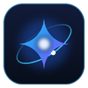

<p align="center">
  
</p>

<h1 align="center">AGY in Chrome</h1>

<p align="center">
  <em>Direct browser automation bridge for Google Antigravity (<code>agy</code> CLI &amp; Antigravity IDE) and Gemini.<br/>
  <strong>Drive your real Chrome browser with full logins, no domain blocks, and 100% Claude-coexistence.</strong></em>
  <br/>
  <sub>Clean-room open-source MCP browser extension. Standard Model Context Protocol (MCP) support.</sub>
</p>

<p align="center">
  <a href="#key-features">Key Features</a> ·
  <a href="#how-it-coexists-with-claude-in-chrome">Claude Coexistence</a> ·
  <a href="#quick-start-installation">Install Guide</a> ·
  <a href="#agy-mcp-configuration">AGY Config</a> ·
  <a href="#architecture">Architecture</a> ·
  <a href="#tools-reference">Tools Reference</a>
</p>

---

> [!NOTE]
> **Attribution & Origin:** This project is built upon the open-source codebase of [**noemica-io/open-claude-in-chrome**](https://github.com/noemica-io/open-claude-in-chrome). It has been refactored, decoupled, and redesigned specifically for **Google Antigravity (`agy` CLI & Antigravity IDE)** and **Gemini**, enabling full coexistence with Claude without port, socket, or tab conflicts.

## Overview

**AGY in Chrome** connects **Google Antigravity (`agy` CLI & Antigravity IDE)** directly to your real, daily Chrome browser via the **Model Context Protocol (MCP)** and **Chrome Native Messaging**.

Unlike standard sandboxed headless browsers, AGY in Chrome gives your AI agent access to your active browser context — including existing logins, authenticated sessions, cookies, and extensions — while giving you full visual transparency over what the agent does.

---

## Key Features

- **No Domain Blocklists**: Official Claude in Chrome blocks 58+ domains (Reddit, Twitter/X, banking, crypto, news sites). AGY in Chrome has **zero restrictions** — automate anywhere across the web.
- **Zero Conflict with Claude in Chrome**: Specially re-engineered to run simultaneously alongside Anthropic's official extension on the same machine without colliding over registry entries, sockets, or tab groups.
- **Dedicated `AGY` Tab Groups**: Automated tabs are grouped under a distinct blue **`AGY`** tab badge in Chrome. AGY never touches, mixes, or accidentally closes your personal or Claude tabs.
- **Dual Execution Engine**:
  - **CDP Mouse & Keyboard (`computer`)**: Real mouse clicks (`mousePressed`, `mouseReleased`), moves, scroll gestures, and typing.
  - **Programmatic DOM (`javascript_tool`, `find`)**: Natural-language DOM selector search and instant in-page JavaScript evaluation.
- **Full Chromium Compatibility**: Runs on Google Chrome, Brave, Arc, Microsoft Edge, and Opera.
- **Token Efficiency**: Decomposes pages into structured refs and accessibility trees instead of burning context window tokens on continuous screenshot loops.

---

## How It Coexists with Claude in Chrome

You can run official Claude (Claude Desktop / Claude Code) and AGY in Chrome **at the same time**:

| Parameter | Official Claude in Chrome | AGY in Chrome |
| :--- | :--- | :--- |
| **Extension Name** | Claude in Chrome | **AGY in Chrome** |
| **Extension ID** | `fcoeoabgfenejglbffodgkkbkcdhcgfn` | Unique unpacked ID (e.g. `enecij...`) |
| **Native Host Identifier** | `com.anthropic.claude_browser_extension` | **`com.antigravity.agy_in_chrome`** |
| **Windows Registry Key** | `HKCU\...\NativeMessagingHosts\com.anthropic.*` | **`HKCU\...\NativeMessagingHosts\com.antigravity.agy_in_chrome`** |
| **IPC Channel (Named Pipe)** | `\\.\pipe\claude-in-chrome-*` | **`\\.\pipe\agy-in-chrome-<user>`** |
| **Tab Group Title** | `Claude` / `MCP` | **`AGY`** (Blue badge) |
| **Config & Logs Path** | `~/.config/open-claude-in-chrome/` | **`~/.config/agy-in-chrome/`** |

---

## Architecture

```
┌─────────────────────────────────────────────────────────────┐
│ Google Antigravity (agy CLI / Antigravity IDE)             │
│                                                             │
│ MCP Client Configuration (~/.gemini/config/mcp_config.json) │
└──────────────────────────────┬──────────────────────────────┘
                               │ Stdio MCP Protocol
                               ▼
┌─────────────────────────────────────────────────────────────┐
│ AGY MCP Server (host/mcp-server.js)                         │
│   • 25 tool schemas (navigate, click, find, screenshot...)  │
└──────────────────────────────┬──────────────────────────────┘
                               │ IPC (Windows Named Pipe / Unix Socket)
                               │ \\.\pipe\agy-in-chrome-<username>
                               ▼
┌─────────────────────────────────────────────────────────────┐
│ Native Messaging Host (host/native-host.js via .bat wrapper)│
│   • Registered in HKCU\...\NativeMessagingHosts             │
└──────────────────────────────┬──────────────────────────────┘
                               │ Chrome Native Messaging (stdin/stdout)
                               ▼
┌─────────────────────────────────────────────────────────────┐
│ Chrome Browser Extension (extension/background.js)          │
│   • Manages "AGY" Tab Group                                 │
│   • CDP (Chrome DevTools Protocol) Driver                   │
│   • Real Mouse / Keyboard / DOM / Screenshot dispatch       │
└─────────────────────────────────────────────────────────────┘
```

---

## Quick Start / Installation

### Prerequisites
- Node.js (v18 or higher)
- Google Chrome (or any Chromium browser: Brave, Edge, Arc)
- Google Antigravity (`agy` CLI / Antigravity IDE)

### 1. Clone the repository
```bash
git clone https://github.com/MainMi/agy-in-chrome.git
cd agy-in-chrome
```

### 2. Install dependencies
```bash
cd host
npm install
cd ..
```

### 3. Load the extension in Chrome
1. Open Google Chrome and navigate to `chrome://extensions/`.
2. Toggle **Developer mode** (top-right corner).
3. Click **Load unpacked** (Завантажити розпаковане).
4. Select the `extension/` directory from this repository.
5. Copy the generated **Extension ID** (e.g. `enecijfblfmdfocicipbjdeepchdnlco`).

### 4. Register the Native Messaging Host

#### On Windows (PowerShell):
Run the automated registration script (no administrator privileges required):
```powershell
powershell -ExecutionPolicy Bypass -File .\register-host.ps1 -ExtensionId "<YOUR_EXTENSION_ID>"
```

#### On macOS / Linux (Bash):
```bash
chmod +x ./install.sh
./install.sh <YOUR_EXTENSION_ID>
```

### 5. Restart Chrome
Completely quit Chrome (ensure all background processes are closed) and launch Chrome again.

---

## AGY MCP Configuration

To make AGY discover and use your Chrome browser tools, add the server to your Antigravity global MCP configuration file:

**Location:** `~/.gemini/config/mcp_config.json` (or `C:\Users\<User>\.gemini\config\mcp_config.json` on Windows):

```json
{
  "mcpServers": {
    "agy-in-chrome": {
      "command": "node",
      "args": [
        "C:\\Programm-Code\\AI\\agy-in-chrome\\host\\mcp-server.js"
      ]
    }
  }
}
```

Now launch `agy` or restart your session — all browser automation tools will be natively available!

---

## Tools Reference

AGY in Chrome exposes 25 tools through the Model Context Protocol:

### Navigation & Tab Management
| Tool | Description |
| :--- | :--- |
| `tabs_context_mcp` | List active tabs in the **AGY** tab group or create a new group. |
| `tabs_create_mcp` | Create a new tab inside the isolated AGY group. |
| `tabs_close_mcp` | Close a tab safely without touching other tabs. |
| `navigate` | Navigate to a URL, go back, or go forward. |
| `set_tab_focus` | Bring the target tab and browser window to the foreground. |

### Interaction & Simulation
| Tool | Description |
| :--- | :--- |
| `computer` | Real mouse and keyboard actions: `left_click`, `right_click`, `double_click`, `left_click_drag`, `type`, `key`, `scroll`, `wait`, `screenshot`, `zoom`. |
| `form_input` | Fill form inputs, textareas, checkboxes, dropdowns, and radios. |

### DOM Inspection & Text Extraction
| Tool | Description |
| :--- | :--- |
| `find` | Natural-language element search (e.g. `"Add to Cart"`, `"Search input"`). |
| `read_page` | Generates a clean accessibility tree with interactive element references (`ref_1`, `ref_2`). |
| `get_page_text` | Extracts readable page text and title without HTML noise. |
| `javascript_tool` | Evaluates arbitrary JavaScript in the page context. |

### Diagnostics & Monitoring
| Tool | Description |
| :--- | :--- |
| `read_console_messages` | Read console logs and errors from the current tab. |
| `read_network_requests` | Inspect HTTP/HTTPS network requests, headers, and statuses. |
| `gif_creator` | Record interactions and export them as animated GIFs. |

---

## Project Structure

```
agy-in-chrome/
├── extension/                  # Manifest V3 Chrome Extension
│   ├── manifest.json           # Extension manifest (AGY in Chrome)
│   ├── background.js           # Service worker, CDP bridge, tab group management
│   ├── content.js              # In-page accessibility tree & DOM ref resolver
│   ├── audit/                  # Audit trail logger (rrweb-based)
│   ├── humanize/               # Natural mouse movement & typing humanizer
│   ├── recorder/               # Demonstration recording & options UI
│   └── icons/                  # Extension icons
├── host/                       # Node.js Native Host & MCP Server
│   ├── mcp-server.js           # Stdio MCP entrypoint for Antigravity
│   ├── native-host.js          # Native Messaging host spawned by Chrome
│   ├── endpoint.js             # Named pipe / socket management
│   ├── tool-runtime.js         # Core tool dispatcher & bridge client
│   ├── tool-definitions.js     # Tool schemas & Zod definitions
│   └── parent-watch.js         # Watchdog process for clean shutdown
├── register-host.ps1           # Windows PowerShell 1-click registration script
├── install.sh                  # macOS / Linux registration script
├── LICENSE                     # MIT License
└── README.md                   # Project documentation
```

---

## License

This project is licensed under the [MIT License](LICENSE).
Portions derived from `noemica-io/open-claude-in-chrome`. Custom modifications for Google Antigravity & AGY independence by MainMi.
